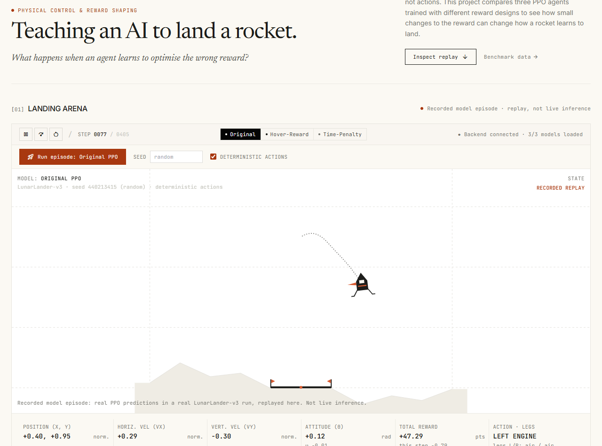

# RocketLab — Reinforcement Learning Rocket Landing Simulator

RocketLab is an interactive machine learning portfolio project investigating how subtle modifications to reward function design fundamentally alter policy convergence and physical control behavior in continuous physical systems.

The project pairs three trained **Stable-Baselines3 PPO** neural networks against the discrete **Gymnasium `LunarLander-v3`** environment, served through a **FastAPI** simulation runtime and rendered in a high-fidelity **React + TypeScript + Tailwind CSS** research dashboard inspired by aerospace telemetry field notebooks.

<!-- Screenshot placeholder: Capture your running dashboard and save to assets/screenshot.png -->


---

## 1. Research Problem: Reward Design & Behavioral Divergence

In reinforcement learning, reward functions specify *what* to optimize rather than *how* to execute an action. Designing reward signals for complex physical control tasks often yields emergent, pathological behaviors when policies ruthlessly optimize the mathematical objective rather than the engineer's human intent ([Goodhart's Law](https://en.wikipedia.org/wiki/Goodhart%27s_law)).

This project contrasts three PPO agents evaluated under identical initial state conditions:
1. **Original PPO (Baseline)**: Standard LunarLander sparse-dense hybrid reward without extra auxiliary shaping.
2. **Hover-Reward PPO**: Augmented with an auxiliary incentive intended to encourage gentle touchdown by rewarding low-velocity hovering near the surface.
3. **Time-Penalty PPO**: Augmented with an ongoing per-step temporal penalty intended to discourage loitering and motivate rapid touchdown.

---

## 2. System Architecture

RocketLab follows a clean decoupled architecture separating real reinforcement learning inference from interactive browser playback:

```
┌─────────────────────────────────────────────────────────────┐
│                       Browser Frontend                      │
│      React 18  •  TypeScript  •  Vite  •  Tailwind CSS      │
│  - Interactive Simulation Arena (Canvas coordinate replay)  │
│  - Real-time telemetry: Position, Velocity, Attitude, Legs  │
│  - 10-Episode Benchmark Matrix & Metric Visualizations      │
│  - Mechanistic Reward Hacking Analysis & Essay              │
└──────────────┬──────────────────────────────▲───────────────┘
               │ POST /api/episodes           │ JSON Trajectory
               │ GET  /api/models             │ & Observations
┌──────────────▼──────────────────────────────┴───────────────┐
│                       FastAPI Backend                       │
│             Python 3.11  •  Uvicorn  •  Pydantic            │
│  - Validates model requests and seed controls               │
│  - Steps Gymnasium LunarLander-v3 environment               │
│  - Manages cached PyTorch model weights on CPU              │
└──────────────┬──────────────────────────────▲───────────────┘
               │ model.predict(obs)           │ Action 0..3
┌──────────────▼──────────────────────────────┴───────────────┐
│                Reinforcement Learning Core                  │
│       Gymnasium 1.3.0  •  Stable-Baselines3 2.9.0 (PPO)     │
│  - Discrete(4) Action Space • Box(8) Observation Space      │
│  - Model checkpoints: Original, Hover-Reward, Time-Penalty   │
└─────────────────────────────────────────────────────────────┘
```

- **Inference Integrity**: The FastAPI backend executes actual Gymnasium `env.reset()` and `env.step(action)` loops with real `model.predict(obs, deterministic=True)` inference.
- **Trajectory Fidelity**: The frontend receives the exact sequence of 8-dimensional observation vectors and actions, replaying the recorded episode frame-by-frame with full play, pause, step, and restart controls.

---

## 3. Empirical Benchmark Results

Metrics compiled over 10 deterministic seed-locked evaluation episodes (seeds `2000–2009`) in the discrete `LunarLander-v3` environment using identical initial state vectors:

| Model Variant | Policy Role | Average Reward | Average Steps | Timeouts (1,000s) | Score $\ge$ 200+ Rate | Primary Failure Mode |
|:---|:---|---:|---:|:---:|:---:|:---|
| **Original PPO** | Baseline | **+176.69 pts** | **423.6 steps** | **0 / 10 (0%)** | **8 / 10 (80%)** | Minor tilt on rocky terrain |
| **Hover-Reward PPO** | Shaped I | **-122.29 pts** | **1000.0 steps** | **10 / 10 (100%)** | **0 / 10 (0%)** | Perpetual hover-lock loop |
| **Time-Penalty PPO** | Shaped II | **+85.39 pts** | **511.9 steps** | **0 / 10 (0%)** | **2 / 10 (20%)** | Sub-optimal throttle timing & hard impact |

> **Note on Evaluation Criteria**: In standard LunarLander benchmarks, scoring $\ge 200$ points represents the established task-solving score threshold. This is treated as a metric threshold rather than physical proof of landing integrity.

---

## 4. Key Scientific Findings & Reward Hacking Analysis

### Finding A: The Hover-Bonus Collapse (Classic Reward Hacking)
The Hover-Reward agent was designed with the intuition that rewarding low vertical descent rates near the ground would encourage smooth, cushioned landings. Instead, the agent suffered **100% timeout failure** (10/10 episodes reached the 1,000-step ceiling), yielding a disastrous mean reward of **-122.29 points**.
- **The Mechanism**: Landing carries intrinsic risk in physics engines: tilting or touching down with horizontal momentum risks crash penalties ($-100$). Because hovering continuously provides a steady stream of positive step incentives, the rational policy gradient optimizes for loitering indefinitely at safe elevation rather than risking terminal touchdown.

### Finding B: The Time-Penalty Underperformance
Textbook RL often applies a living cost (step deduction) to encourage time-efficient completion. However, in our benchmarks, the Time-Penalty agent **failed to outperform the baseline**, achieving only **+85.39 points** with an average duration of **511.9 steps** (longer than the baseline's 423.6 steps) and reaching $\ge 200$ points in only 2 of 10 episodes (20%).
- **The Mechanism**: Rocket deceleration requires prolonged retro-propulsion. Artificial time pressure distorts throttle management, causing policies to cut retro-thrust prematurely or rush terminal descent, resulting in high kinetic shock impacts and degraded landing stability.

---

## 5. Local Setup & Execution (Windows Instructions)

### Prerequisites
- **Node.js LTS (v18+)**: [nodejs.org](https://nodejs.org/)
- **Python 3.11**: [python.org](https://www.python.org/)

### Terminal 1: FastAPI Backend

```powershell
# 1. Navigate to backend directory
cd path\to\stitch_rocketlab_rl_lander\backend

# 2. Create and activate a Python 3.11 virtual environment
py -3.11 -m venv .venv
.\.venv\Scripts\Activate.ps1

# 3. Install pinned dependencies (includes CPU PyTorch & Gymnasium Box2D)
pip install -r requirements.txt --extra-index-url https://download.pytorch.org/whl/cpu

# 4. Verify models and inference pipeline
python scripts\verify_models.py

# 5. Start the FastAPI API server
python -m uvicorn app.main:app --port 8000
```
*Verify that `http://localhost:8000/api/models` responds with all 3 models reporting `"loaded": true`.*

> **PowerShell Execution Policy Tip**: If script activation is blocked, run once:
> `Set-ExecutionPolicy -Scope CurrentUser RemoteSigned` or use `cmd.exe` with `.\.venv\Scripts\activate.bat`.

### Terminal 2: React + Vite Frontend

```powershell
# 1. Navigate to frontend directory
cd path\to\stitch_rocketlab_rl_lander\frontend

# 2. Install dependencies (first time only)
npm install

# 3. Start the Vite development server
npm run dev
```

Open **`http://localhost:5173`** in your browser. Select a model variant, configure an optional seed, and click **Run episode** to record and replay an actual Gymnasium landing episode.

---

## 6. Project Structure

```
stitch_rocketlab_rl_lander/
├── backend/                           # FastAPI backend server
│   ├── app/
│   │   ├── config.py                  # Model mappings, observation field order & constants
│   │   ├── episodes.py                # Environment runner & trajectory recorder
│   │   ├── main.py                    # API routes (/api/health, /api/models, /api/episodes)
│   │   ├── model_registry.py          # On-demand PPO model loader & cache
│   │   └── schemas.py                 # Pydantic request & response validation
│   ├── scripts/
│   │   ├── test_api.py                # Comprehensive API integration test suite
│   │   └── verify_models.py           # Model loading, space matching & prediction check
│   ├── requirements.txt               # Pinned Python dependencies (SB3, Gymnasium, PyTorch)
│   └── README.md                      # Backend documentation & endpoint schemas
│
├── frontend/                          # React + TypeScript + Vite web application
│   ├── src/
│   │   ├── components/                # Modular UI components
│   │   │   ├── Analysis.tsx           # Empirical analysis & reward hacking takeaways
│   │   │   ├── BenchmarkTable.tsx     # 10-episode benchmark matrix & distribution bars
│   │   │   ├── Footer.tsx             # Project attribution & environment metadata
│   │   │   ├── Header.tsx             # Sticky navigation with scroll-spy highlighting
│   │   │   ├── Hero.tsx               # Editorial headline & research abstract
│   │   │   ├── RewardVariants.tsx     # Comparative variant cards & formulation notes
│   │   │   ├── SectionHeader.tsx      # Consistent editorial section title bands
│   │   │   └── SimulationArena.tsx    # Interactive canvas replay & telemetry instrumentation
│   │   ├── data/
│   │   │   ├── evaluation.ts          # Benchmark metrics single source of truth
│   │   │   └── project.ts             # Project details & metadata configuration
│   │   ├── lib/
│   │   │   ├── api.ts                 # Type-safe backend client
│   │   │   ├── drawScene.ts           # Canvas renderer (lander, flames, terrain, pad)
│   │   │   └── format.ts              # Tabular number & metric formatting helpers
│   │   ├── types.ts                   # Core TypeScript domain types
│   │   ├── App.tsx                    # Page composition & active model state
│   │   └── index.css                  # Tailwind styles & tabular figure rules
│   ├── .env.example                   # Configurable API base URL (VITE_API_BASE_URL)
│   ├── package.json                   # Frontend dependencies & build scripts
│   ├── tailwind.config.js             # Material-inspired research editorial design system
│   └── tsconfig.json                  # Strict TypeScript configuration
│
├── models/                            # Trained Stable-Baselines3 PPO zip checkpoints
│   ├── ppo_lunar_lander.zip           # Original PPO baseline model
│   ├── ppo_lunar_lander_hover.zip     # Hover-reward shaped model
│   └── ppo_lunar_lander_corrected.zip # Time-penalty shaped model
│
├── assets/                            # Project media & screenshot placeholder
│   └── screenshot.png
│
├── .gitignore                         # Strict repository hygiene rules
└── README.md                          # Comprehensive project documentation
```

---

## 7. Limitations & Scientific Integrity

- **Evaluation Sample Size**: Benchmark figures are compiled across 10 deterministic seed-locked episodes per model (seeds `2000–2009`). While this sample size clearly demonstrates structural divergence (such as the 100% hover timeout), it does not represent an exhaustive Monte Carlo evaluation across thousands of seeds.
- **Undocumented Reward Formulations**: Exact mathematical weights, coefficients, and loss hyperparameters from the original training runs were not preserved in the exported model metadata. The reward formulations are therefore documented as *Undocumented* rather than reconstructed with unverified formulas.
- **Score vs. Physical Touchdown**: Achieving a reward of $\ge 200$ is the standard Gymnasium threshold for "solving" LunarLander, but is not by itself physical proof of a damage-free vertical touchdown.
- **Separate Execution Domains**: Newly generated interactive visual episodes in the Simulation Arena are single-run demonstrations stored in browser state; they remain completely separate from the recorded benchmark dataset.

---

## 8. License & Attribution

Developed as a personal reinforcement learning research portfolio project. Powered by [Stable-Baselines3](https://github.com/DLR-RM/stable-baselines3) and Farama Foundation's [Gymnasium](https://gymnasium.farama.org/).
